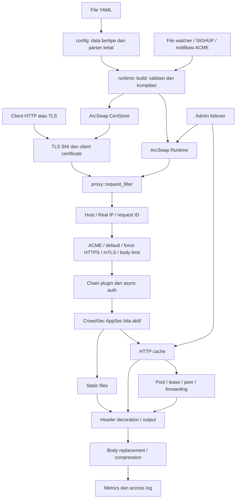

# Audit mendalam Conduit

Tanggal pemeriksaan: 10 November 2026. Bahasa laporan: Indonesia.

**Putaran perbaikan:** [FIX_VALIDATION.md](FIX_VALIDATION.md) mencatat patch dan hasil uji terbaru. Bagian di bawah merupakan snapshot audit/recheck sebelum perbaikan; pernyataan bahwa kode belum diubah atau suite belum dijalankan hanya berlaku pada putaran historis tersebut.

**Status terbaru setelah recheck:** lihat [RECHECK.md](RECHECK.md). Tujuh temuan implementasi terkonfirmasi dengan eksekusi Rust/binary; F04 ditarik sebagai bug, F08 sebagian valid/kontrak ambigu, F10 dokumentasi saja. Uraian metode putaran awal dipertahankan sebagai riwayat; status runtime terbaru dijelaskan di bawah.

**Kesimpulan:** pemisahan konfigurasi dan runtime, lifecycle request, RAII untuk penghitung, serta pengujian gangguan menunjukkan desain yang serius. Namun ada ketidaksesuaian representasi path dan identitas cache yang perlu dibereskan sebelum menyimpulkan bahwa batas keamanan seluruh fitur konsisten. Kualitas arsitektur tidak otomatis membuktikan keamanan kombinasi fitur.

## Cara membaca paket audit

- [Temuan dan rencana verifikasi](FINDINGS.md): akar masalah, prasyarat, dampak, usulan perbaikan dan tes regresi.
- [Verifikasi ulang dan koreksi](RECHECK.md): keputusan bug vs false positive dengan kontrol HTTP/TLS dan native Rust.
- [Bedah modul dan folder](WALKTHROUGH.md): tanggung jawab, alur data, keputusan desain dan titik perhatian setiap modul aplikasi serta perangkat pendukung.
- [Inventaris seluruh file](INVENTORY.md): ukuran, jumlah baris, hash, cakupan graph, simbol dan test yang ditemukan secara statis.
- [Penjelajah sumber bernomor baris](SOURCE.html): snapshot teks, navigasi file, pencarian dan penanda baris temuan. Ini alat penelusuran setiap baris, bukan bukti bahwa setiap baris telah diuji.
- [Data inventaris](inventory.json): bukti snapshot dan statistik dalam format terstruktur.
- [Demonstrasi offline](reproduce.py), dengan [hasil eksekusi](reproduction-results.json): tujuh demonstrasi algoritme/interleaving, tanpa menjalankan binary Rust.
- [Hasil pemeriksaan statis](checks.json): hasil validasi sintaks dan batas verifikasi.

## Cakupan dan batas kejujuran

Checkout awal memuat 363 file tracked yang tersedia sebagai file reguler, 29 file Rust di `src/` dengan 18.925 baris, dan `tests/e2e.rs` dengan 5.160 baris. Angka baris memakai `splitlines()`; inventaris merekam nilai per file. Graph lama memuat 2.301 node, 5.224 edge dan 138 komunitas. Dari edge tersebut, 5.186 berlabel `EXTRACTED` dan 38 `INFERRED`. Sebanyak 444 node tidak membawa `source_file`; node semacam itu bukan bukti implementasi lokal.

Audit ini mencakup penelusuran statis modul aplikasi, konfigurasi, deployment, alat build/benchmark/fuzzing, dokumentasi, serta struktur skenario pengujian. Titik yang berisiko ditelusuri lintas file dan sampai ke operasi yang menentukan perilaku. Lampiran mencatat semua file tracked yang tersedia, termasuk seed dan aset.

**Tidak ada klaim audit semantik manual setiap baris seluruh repository.** Banyak baris merupakan data uji, tabel signature, kode harness, aset SVG atau hasil graph. Inventaris dan penjelajah sumber memastikan baris-baris itu dapat ditelusuri, tetapi penilaian mendalam berpusat pada alur executable dan interaksi fitur. Membaca snapshot bernomor baris bukan pengganti membuktikan perilakunya.

Pada audit awal, `cargo` dan `rustc` tidak tersedia pada PATH. Percobaan test gagal sebelum Cargo dijalankan. Submodule lokal `vendor/pingora` juga kosong. **Pada recheck batas ini diatasi:** rustc 1.99.1 serta fork pada gitlink tepat `5c765c66590bdb7829ad32e00abc6f9a4e0410af` disiapkan di salinan sementara. Semua file implementasi identik berdasarkan hash. Status kini:

1. Build berhasil; existing unit **109 passed / 2 ignored**, e2e `file_server` dan `response_cache` masing-masing lulus. Empat native recheck, satu test fallback fungsi asli dan tujuh skenario HTTP/TLS selesai. Full-suite e2e, clippy, fuzz dan benchmark baru **tidak diklaim**.
2. Source fork terkait cache variance/rate estimator sudah dibaca pada commit terkunci. Audit seluruh patch fork belum dilakukan; patch lain tetap merujuk dokumentasi proyek.
3. Klaim benchmark, soak 24 jam dan replay 1,1 juta request di README **belum direproduksi**.
4. Tidak ada audit advisory dependency terkini; `Cargo.lock` saja tidak membuktikan bebas CVE.
5. Tidak ada sistem production, kredensial, API eksternal atau host deployment yang diakses.

Kode aplikasi tidak diubah; hasil pekerjaan berupa artefak audit dan metadata refleksi Graphify lokal.

Pemeriksaan yang berhasil dijalankan: parse AST lima file Python repository dan dua script audit, `bash -n` delapan script shell, parse empat heredoc Python, parse tiga manifest TOML dan XML 16 SVG, serta tujuh demonstrasi offline. Seluruh tautan relatif Markdown laporan ditemukan dan hash 363 file sumber tetap sama. Graph tidak mempunyai dangling edge atau ID node duplikat secara struktural. Semua ini adalah pemeriksaan statis/model, bukan pengganti build, test Rust atau validasi visual logo. Query graph memakai artefak yang sudah ada; tidak ada ekstraksi LLM baru atau pengukuran biaya token Graphify baru.

## Ringkasan temuan

P1 berarti prioritas tinggi pada konfigurasi yang memenuhi prasyarat; bukan klaim eksploitasi universal. P2 berarti masalah correctness/reliability atau keamanan bersyarat yang perlu diperbaiki. P3 berarti ketidaksesuaian dokumentasi.

| ID | Prioritas | Temuan | Kondisi utama |
|---|---|---|---|
| F01 | P1 | Path file server di-percent-decode dua kali; keputusan plugin dapat berbeda dari file yang dibuka | `files` bersama rule/auth berbasis path |
| F02 | P1 bersyarat | Fallback `canonicalize` lalu `open` kehilangan jaminan containment atomik | `openat2` tidak tersedia dan pihak lain bisa mengganti path |
| F03 | P1 bersyarat | Cache menghapus port Host dari identitas, upstream tetap menerima port | Cache aktif dan origin menghasilkan respons berdasarkan authority |
| F04 | Ditarik sebagai bug | Retensi fresh cache sesuai kontrak TTL/purge | Invalidasi cutover otomatis merupakan usulan fitur |
| F05 | P2 | Perkalian duration tidak diperiksa overflow | Nilai durasi konfigurasi sangat besar |
| F06 | P2 | `watch_interval: 0` lolos build konfigurasi menuju `tokio::time::interval` | Konfigurasi operator bernilai nol |
| F07 | P2 | Rate-limit admission memisahkan baca kuota dan penambahan | Request bersamaan pada beberapa worker |
| F08 | Sebagian valid | Override wildcard berkontrak ambigu; warning coverage salah terbukti | Bug warning kecil, bukan bypass TLS |
| F09 | P2 | Normalisasi `Vary: Accept-Encoding` menggabungkan coding di luar tiga bit yang dikenal | Origin memakai coding seperti `deflate` |
| F10 | Dokumentasi | README terlalu absolut; implementation dan test memang pass-through | Perbaiki README, bukan otomatis ubah kode |

F01/F02/F03/F05/F06/F07/F09 kini terkonfirmasi lewat Rust/binary. F04 bukan bug hanya karena perilakunya dapat direproduksi. F08 dibatasi pada warning salah dan kontrak override yang ambigu; F10 hanya README. [Matriks recheck](RECHECK.md) dan [hasil binary](recheck-runtime-results.json) menjadi bukti terbaru; demonstrasi Python awal tetap diberi label model.

## Arsitektur yang terbentuk

Diagram ini merupakan sintesis pembacaan kode, bukan seluruhnya edge Graphify. Jalur file lokal tidak menjalankan transformasi body_replace sebagaimana respons upstream; detail fase dibahas di walkthrough. Header response plugin diaplikasikan ke jawaban lokal melalui `decorate`.

### Invarian yang benar-benar penting

1. **Satu snapshot runtime per request.** `request_filter` memuat `load_full()` lalu menyimpan Arc di `Ctx`. Hook selanjutnya memakai `ctx.rt` dan `ctx.site`; ini cocok dengan pola consistent snapshot ArcSwap.
2. **Satu representasi path untuk keputusan keamanan dan akses resource.** F01 melanggar ini: pemeriksaan memakai hasil normalisasi pertama, file lookup menormalisasi hasilnya lagi.
3. **Identitas cache harus mencakup input pembeda resource pada kontrak aktif.** Kode sudah memasukkan hasil forward-auth, fingerprint mTLS dan route tertentu, tetapi authority port belum tercakup. Invalidasi pada perubahan konfigurasi adalah kebijakan tambahan, bukan otomatis bug pada kontrak fresh-cache sekarang.
4. **Resource admission harus dilepas pada semua jalur akhir.** `Held`, `Lease`, `Published` dan `Ctx::drop` memanfaatkan RAII. Ini membantu ketika request error atau task dibatalkan.
5. **Validasi tidak boleh bergantung pada efek samping startup yang baru panik kemudian.** F05/F06 menunjukkan celah pada domain numerik konfigurasi.
6. **Dokumentasi jaminan kernel harus menyebut fallback yang lebih lemah.** `openat2` normal memberi jaminan yang berbeda dari `realpath` lalu pembukaan biasa.

## Temuan Graphify dan cara menafsirkannya

Graph digunakan melalui query arsitektur dan query `runtime reload tls config`. Query yang lebar terpotong oleh budget, sehingga bukan bukti bahwa seluruh subgraph telah dibaca. Untuk penelusuran berikutnya digunakan pembacaan file sumber langsung.

Vocabulary yang dipilih dari label graph: `request`, `runtime`, `cache`, `auth`, `reload`, `tls`, `pool`, `files`, `plugins`, `config`, `health`, `metrics`.

Node ber-degree tinggi didominasi node **file**, misalnya `docs/technical.md` (156), `src/proxy.rs` (141), `tests/e2e.rs` (141), `src/crowdsec.rs` (101), `src/acme.rs` (99) dan `src/cache.rs` (98). Degree ini mengukur hubungan graph termasuk containment/dokumentasi; **bukan** jumlah caller runtime, kompleksitas siklomatik atau bukti bahwa modul tersebut cacat.

Hub yang paling berguna secara operasional adalah `proxy.rs`: keputusan site menghubungkan identitas, policy, file, cache, auth, upstream dan observability. Tiga hubungan yang paling bernilai untuk audit justru berupa kontrak lintas modul:

- `pathnorm` → matcher plugin → `Files::find`: menghasilkan F01, yang tidak tampak jika normalizer dan file opener ditinjau terpisah.
- `request_host` → `original_host` → `cache::key`: menghasilkan F03 karena tiga fase memakai identitas host dengan tujuan berbeda.
- `runtime::build` → `reload` → cache global: menjelaskan F04. Klasifikasi bug ditarik karena retensi cache tersebut didokumentasikan.

Graph telah ada sebelum audit dan sengaja tidak dibangun ulang. Semua source_file graph yang tidak kosong masih ditemukan di checkout. Itu memverifikasi keberadaan, **tidak** membuktikan hash/line graph masih identik; rujukan temuan menggunakan nomor baris file aktual. File vendor dikecualikan oleh `.graphifyignore` sehingga graph memang tidak dapat membuktikan perilaku fork tersebut.

## Pemeriksaan dokumentasi terkini

Context7 dipakai dengan resolve-library-id lebih dulu, kemudian query dokumentasi:

| Library | ID yang dipilih | Hasil dan implikasi |
|---|---|---|
| Pingora | `/cloudflare/pingora` | Fase request dan response diverifikasi; upstream response hooks terjadi sebelum penyimpanan cache. Dokumen tersedia berasal dari branch main, bukan jaminan kecocokan fork 0.9.1 |
| ArcSwap | `/websites/rs_arc-swap_arc_swap` | Menyimpan satu snapshot per unit kerja adalah pola yang dianjurkan; penggunaan snapshot di Ctx sesuai |
| Tokio | `/tokio-rs/tokio/tokio-1.54.1` | Resolusi berhasil, query khusus spawn_blocking tidak mendapat dokumen; hasil kosong tidak dianggap bukti |

Untuk Tokio dilakukan fallback ke dokumentasi API resmi: [`interval`](https://docs.rs/tokio/latest/tokio/time/fn.interval.html) menyebut panic untuk periode nol. [`spawn_blocking`](https://docs.rs/tokio/latest/tokio/task/fn.spawn_blocking.html) menjelaskan semaphore untuk membatasi pekerjaan CPU serta bahwa task yang sudah berjalan tidak dapat dibatalkan; penahanan permit bcrypt di dalam closure sudah tepat.

Sumber lain: [fase Pingora](https://github.com/cloudflare/pingora/blob/main/docs/user_guide/phase.md), [consistent snapshots ArcSwap](https://docs.rs/arc-swap/latest/arc_swap/docs/patterns/index.html), [ArcSwapAny::load](https://docs.rs/arc-swap/latest/arc_swap/struct.ArcSwapAny.html). Tidak ada kode privat/kredensial yang dikirim dalam query dokumentasi.

## Pengujian: apa yang ada dan apa yang masih hilang

Pemindaian menemukan 111 fungsi test di `src/` dan 20 e2e; ini bukan persentase line coverage. Recheck menjalankan unit: 109 passed, 2 ignored. Dua e2e terarah (`file_server`, `response_cache`) lulus; full suite tidak diklaim. Pebble ACME, CrowdSec Docker dan slow header diabaikan secara default. Tujuh fuzz target tersedia, belum dijalankan ulang.

Kekuatan suite adalah menguji binary nyata, rotasi sertifikat, reload saat traffic, upgrade dengan WebSocket terbuka, body streaming, upstream flapping, koneksi idle/malformed dan kehabisan FD. Test body replacement memotong input pada banyak batas chunk; differential oracle log membandingkan encoder manual dengan serde_json; exploit engine membandingkan prefilter dengan scanner lambat.

Yang belum menjadi jaminan dari suite itu:

- Path fuzz memeriksa bentuk output normalizer, belum kesamaan resource antara hasil pemeriksaan auth dan file lookup.
- Request fuzz tidak menjalankan seluruh async pipeline auth, AppSec, storage lookup dan network peer.
- Fuzz config membatasi sejumlah path/DNS, tetapi filter berdasarkan substring teks bukan sandbox OS; jalankan fuzz di lingkungan disposable.
- Test limiter yang ada tidak membuktikan admission atomik antarworker.
- E2E cache yang luas belum menggantikan matriks authority-port, config generation dan content coding tak dikenal.
- PGO training dan benchmark bukan correctness/security test.
- Kode harness tersedia, tetapi hasil mentah soak dan benchmark tidak tersedia sebagai bukti reproduksi audit ini.

## Urutan tindak lanjut

1. **Tutup celah representasi resource:** normalisasi path satu kali, desain containment fallback, buat regresi F01/F02.
2. **Tegaskan identitas representasi:** authority kanonis yang sama antara upstream dan cache; perbaiki variance coding. Namespace konfigurasi hanya bila kebijakan invalidasi otomatis memang dipilih.
3. **Tegaskan validasi/admission:** checked arithmetic, periode watcher positif, dan operasi rate-limit yang mengikat keputusan dengan pencatatan.
4. **Perbaiki warning TLS wildcard dan kontrak dokumentasi:** pertegas dukungan override wildcard; README server_header perlu diselaraskan dengan pass-through yang disengaja.
5. **Perluas verifikasi seperlunya:** build/unit/recheck terarah sudah dilakukan. Full e2e, lint, tes Docker ignored dan fuzz tetap pekerjaan terpisah.
6. **Audit fork terpisah:** task pipe, pooling idle, header parsing/serialization, timeout seluruh header, daemon readiness dan finalisasi compressor adalah perubahan yang memengaruhi trust boundary.

Tidak diperlukan penggantian arsitektur besar untuk menutup mayoritas temuan. Perubahan paling bernilai adalah menyatukan representasi yang dipakai lintas fase dan memperjelas lifecycle state global.
